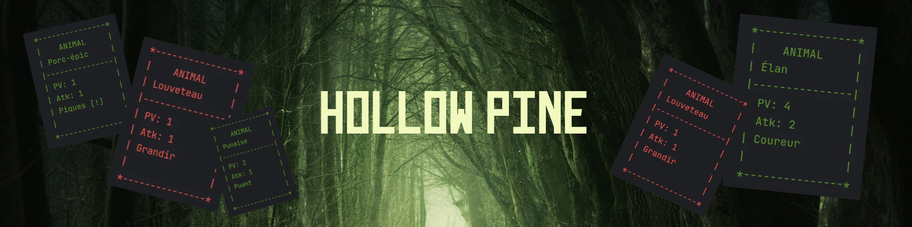
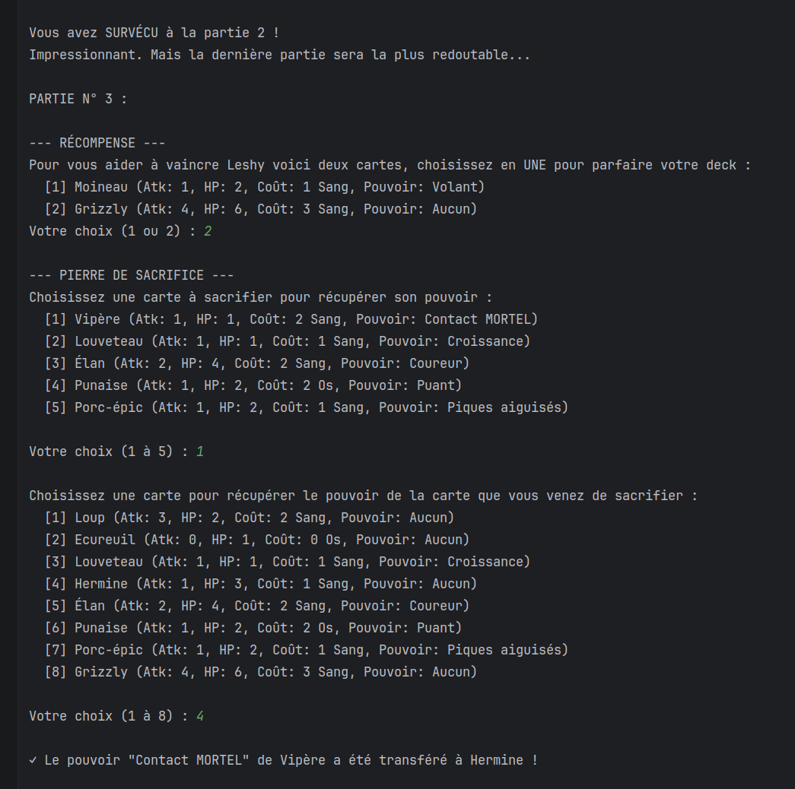

<p align="center">
  
</p>

# Hollow Pine

Hollow Pine est une application console réalisée en trinôme dans le cadre d'un projet (BUT Informatique, Université de Strasbourg). 

> Une cabane isolée au coeur d'une forêt silencieuse, un adversaire aux yeux inquiétants, et un étrange jeu de cartes dont vous ne repartirez qu'en le gagnant...


## ♤ Le jeu original

Hollow Pine s'inspire d'**Inscryption** (Daniel Mullins Games, 2021), un jeu vidéo qui mélange jeu de cartes, roguelike et ambiance d'horreur. Son système de coûts est original : on paie en **sacrifiant ses propres créatures** (gouttes de sang) ou en dépensant les **os** des créatures mortes, et les cartes possèdent des **pouvoirs** qui changent la façon de jouer.

Hollow Pine reprend ces principes dans une version **très simplifiée**, en mode console. Plus d'informations sur le jeu original : [Wikipédia](https://fr.wikipedia.org/wiki/Inscryption).

## ♤ Le projet

<br>

| Contraintes  |                                           |
|--------------|-------------------------------------------|
| Durée        | 5 semaines (mai à juin 2026)              |
| Équipe       | Trinôme                                   |
| Technologies | Java, JUnit, PlantUML, Git, IntelliJ IDEA |
| Rendus       | Un rendu par semaine, plus un rendu final |

### Une progression en deux phases

Le sujet a été conçu en deux phases, avec des rendus hebdomadaires, pour découper le travail en petites tâches et faire évoluer le code au fil des semaines.

- **Phase 1** : les bases du jeu (plateau, cartes, pioche, tours, score)
- **Phase 2** : les pouvoirs des cartes, l'ajout d'une carte à la pioche et la pierre de sacrifice, qui demandent un code facile à étendre

### Compétences acquises et mises en pratique

- **Programmation orientée objet** : un code découpé en classes, chacune avec une responsabilité claire
- **Code propre** : respect des conventions de code et des principes SOLID pour un code facile à faire évoluer
- **Tests unitaires** : 79 tests JUnit 5 sur les classes les plus importantes
- **Modélisation** : diagrammes de classes UML (PlantUML), mis à jour chaque semaine

## ♤ Déroulement du jeu

Face à vous, **Leshy** joue sur la ligne du haut ; vous jouez sur la ligne du bas, qui compte quatre emplacements (de `1` à `4`). Le premier à creuser **5 points d'écart** (la balance, à gauche du plateau) remporte la partie, et il faut gagner les **3 parties**, de plus en plus difficiles, pour s'échapper de ses griffes.

> 📖 Toutes les règles (cartes, pouvoirs, obstacles, coûts en sang et en os) sont détaillées dans [docs/REGLES.md](docs/REGLES.md).

### 1. Annonce de l'adversaire et pioche

La ligne du haut annonce les cartes que Leshy jouera au tour suivant, puis le jeu vous propose de piocher.


### 2. Pose des cartes

Vous choisissez une carte de votre main (par sa lettre), puis un emplacement, en payant son coût en sang ou en os. Les pouvoirs des cartes sont affichés directement dessus.


### 3. Attaques et score

Quand vous terminez votre tour, vos cartes attaquent. Les événements du tour s'affichent sous le plateau, puis Leshy joue à son tour.


### 4. Fin de la deuxième partie

Après la deuxième partie, vous choisissez une nouvelle carte parmi deux, puis vous pouvez utiliser la **pierre de sacrifice** pour transférer le pouvoir d'une carte à une autre.



### Commandes

Les saisies fonctionnent en majuscules comme en minuscules.

| Saisie | Moment | Effet |
|---|---|---|
| `OUI` / `NON` | Début de tour | Piocher ou non une carte |
| `P` | Menu d'actions | Placer une carte sur le plateau |
| `F` | Menu d'actions | Finir le tour |
| `A`, `B`, `C`... | Choix de la carte | Choisir une carte de la main (`X` pour annuler) |
| `1` à `4` | Choix de l'emplacement | Poser la carte, ou désigner l'animal à sacrifier |
| `1`, `2`... | Récompense et pierre de sacrifice | Choisir une carte dans la liste proposée |

Les saisies invalides sont refusées et redemandées, avec une explication.

## ♤ Installation et lancement

**Prérequis** : Java JDK 21 ou plus récent et Git.

> ⚠️ Vérifiez que **les deux** commandes `java -version` et `javac -version` affichent la version 21 ou plus. Sous Linux, il arrive que `java` soit en 21 et `javac` (le compilateur) en 17 : la compilation échoue alors avec des erreurs `cannot find symbol` sur `getFirst()` ou `removeFirst()`. Dans ce cas, installez le JDK complet (`sudo apt install openjdk-21-jdk` sous Ubuntu).

```bash
git clone https://github.com/Thalioukill/hollow-pine-game.git
cd hollow-pine-game
```

**Avec IntelliJ IDEA** : ouvrez le dossier du projet (*File > Open*), puis lancez `src/Main.java`.

**En ligne de commande** :

```bash
# 1. Créer le dossier qui recevra les fichiers compilés (sans erreur s'il existe déjà)
mkdir -p out

# 2. Compiler tous les fichiers .java de src/ vers out/
javac -d out $(find src -name "*.java")

# 3. Lancer le jeu (Main est le point d'entrée du programme)
java -cp out Main
```

À lancer depuis la racine du projet (le dossier qui contient `src/`).

## ♤ Lancer les tests

Les tests utilisent JUnit 5 (lanceur fourni dans `deps/`) et couvrent les pouvoirs, le plateau, les cartes, la gestion de partie, l'adversaire et le joueur.

```bash
# 1. Compiler le jeu et les tests, en ajoutant JUnit (deps/) au classpath
mkdir -p out/tests
javac -cp "deps/*" -d out/tests $(find src tests -name "*.java")

# 2. Lancer tous les tests trouvés dans les classes compilées
java -jar deps/junit-platform-console-standalone.jar execute --class-path out/tests --scan-class-path
```

À la fin, le résumé doit indiquer `0 tests failed`. Dans IntelliJ, vous pouvez aussi faire un clic droit sur le dossier `tests` puis *Run Tests*.

## ♤ Structure du dépôt

```
hollow-pine-game/
├── deps/                           # bibliothèques de test (JUnit, Hamcrest)
│   ├── hamcrest-core-1.3.jar
│   ├── junit-4.13.2.jar
│   └── junit-platform-console-standalone.jar   # lanceur JUnit 5
├── docs/
│   └── REGLES.md                   # règles détaillées du jeu
├── assets/                         # images et vidéos du README
│   ├── banner_hollow_pine.png
│   └── sacrifice_stone.png      
├── out/
│   └── .gitkeep                    # dossier des fichiers compilés (ignorés par Git)
├── src/
│   ├── Main.java                   # point d'entrée
│   ├── game/                       # classes gérant les parties et leur déroulement
│   │   ├── Game.java               # mécanique d'une partie
│   │   ├── GameManager.java        # mécanique du jeu (enchaînement des 3 parties)
│   │   └── strategy/               # une stratégie par partie, pour le jeu de l'adversaire
│   │       ├── GameStrategy.java   # interface
│   │       ├── FirstGame.java
│   │       ├── SecondGame.java
│   │       └── ThirdGame.java
│   ├── model/
│   │   ├── abilities/              # tous les pouvoirs possibles des cartes
│   │   │   ├── Ability.java
│   │   │   ├── AbilityType.java
│   │   │   ├── DeathTouchAbility.java
│   │   │   ├── FlyingAbility.java
│   │   │   ├── GrowthAbility.java
│   │   │   ├── MultipleLivesAbility.java
│   │   │   ├── RunnerAbility.java
│   │   │   ├── SharpQuillsAbility.java
│   │   │   └── StinkyAbility.java
│   │   ├── board/                  # une ligne du plateau
│   │   │   └── BoardLine.java
│   │   ├── cards/                  # les cartes (animaux et obstacles)
│   │   │   ├── Card.java
│   │   │   ├── Animal.java
│   │   │   ├── AnimalType.java
│   │   │   ├── Obstacle.java
│   │   │   └── ObstacleType.java
│   │   ├── players/                # le joueur et son adversaire
│   │   │   ├── Player.java
│   │   │   ├── User.java
│   │   │   └── Opponent.java
│   │   └── stock/                  # « base de données » des informations pour fabriquer les cartes
│   │       ├── AnimalStock.java
│   │       └── ObstacleStock.java
│   ├── textColors/                 # couleurs de l'affichage
│   │   └── Color.java
│   └── view/
│       ├── GameBoard.java          # affichage du plateau, du score et de la pioche
│       └── Interactions.java       # gestion des entrées et sorties de l'utilisateur
├── tests/                          # 79 tests unitaires JUnit 5
│   ├── AbilitiesTest.java
│   ├── BoardLineTest.java
│   ├── CardTest.java
│   ├── GameManagerTest.java
│   ├── GameTest.java
│   ├── OpponentTest.java
│   └── UserTest.java
├── uml/
│   └── diagramme_UML.puml          # diagramme de classes (PlantUML)
├── .gitignore
└── README.md
```

Chaque pouvoir est une classe séparée, ce qui permet d'en ajouter un sans modifier le reste du code. De même, chaque partie correspond à une stratégie (`FirstGame`, `SecondGame`, `ThirdGame`) qui implémente `GameStrategy`.

## ♤ Conception

Le diagramme de classes se trouve dans `uml/diagramme_UML.puml` (lisible avec PlantUML). L'affichage et les saisies sont regroupés dans le package `view`, séparés de la logique du jeu, et le code est organisé en packages.


## ♤ Crédits

- **Jeu d'origine** : *Inscryption* (Daniel Mullins Games), dont Hollow Pine reprend les grands principes sous une forme simplifiée.
- **Cadre pédagogique** : projet réalisé à l'IUT Robert Schuman (département informatique), qui en a fourni le sujet, l'encadrement et les conseils.
- **Statut** : exercice pédagogique sans but commercial, non affilié aux auteurs du jeu original.
  

## ♤ Licence

Code distribué sous licence MIT (voir le fichier [LICENSE](LICENSE)).

© 2026 Thalia Herzog, Chuluunkhuu Khosgerel et Fanny Hertz

